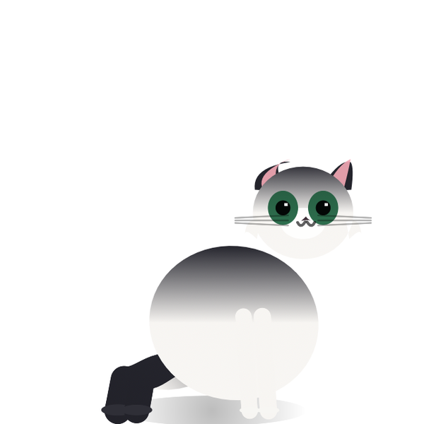
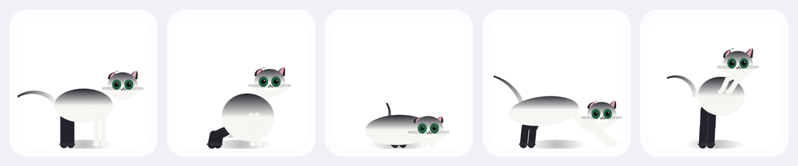
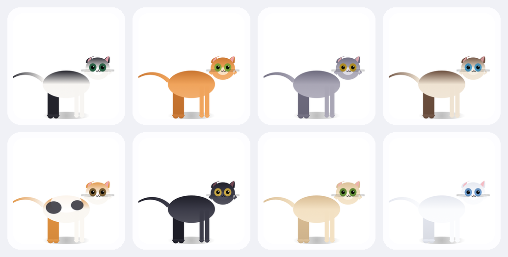
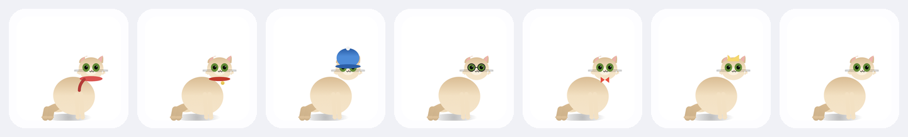

# 🐾 PCCat

A desktop cat companion for macOS. PCCat lives on your screen — not in an app
window — as a floating, always-on-top panel. It breathes, blinks, walks, naps,
chats, and keeps its own daily rhythm, just like the real cat it's pretending to be.

Inspired by [Furever Dock](https://www.fureverdock.com/), rebuilt from scratch as a
small, fast, native app with a procedural cat instead of sprite sheets.



## What it does

- **Procedural cat rig** — a 4-limb skeleton with gradient fur, curling tail and
  expressive eyes, blended frame-by-frame at 60 fps. No sprites, no animation files.
- **Eight species** — tuxedo, ginger, silver tabby, siamese, calico, midnight,
  caramel cream and snowball, each with its own fur and eye palette.
- **Seven accessories** — scarf, collar & bell, beanie, glasses, bow tie and a
  tiny crown.
- **Daily rhythm** — wakes up and stretches, helps you in the morning, wants to
  play in the afternoon, nags you to stretch and hydrate at break time, and is
  fast asleep by 9:30 pm.
- **AI companion** — chat through the Claude API with a warm cat persona. The cat
  can create reminders and store durable facts about you (`remember` tool).
  Your API key lives in the macOS Keychain, never in the file system.
- **Living needs** — mood, energy, hunger and affection drift over time; the cat
  murmurs to itself, asks for food, and naps when it's tired.
- **Quick actions** — hover the cat: feed, water, tricks (sit / high five / spin), pet.
- **Polish** — settings window, saved panel position, status-bar item,
  ad-hoc-signed app bundle, persistent chat + memory + reminders.

### Postures



### Species



### Accessories



## Getting started

Requires **macOS 14+** and only the **Command Line Tools** (`xcode-select --install`).
No Xcode project needed — PCCat builds with plain Swift Package Manager.

```bash
# clone
git clone https://github.com/itxRishabh/mac-cat.git
cd mac-cat

# build and launch
./build.sh
open dist/PCCat.app
```

Or run the development build directly:

```bash
swift build && .build/debug/PCCat
```

Once it's running, the cat appears in the bottom-right of your screen. Drag it
anywhere — it stays above every window and appears on all desktops.

### Enable AI chat

Open **Settings → AI** (from the menu-bar paw icon) and paste an Anthropic API
key. It is stored in the Keychain under `com.pccat.apikey` and only ever sent
to `api.anthropic.com`.

| Model (default) | Use it for |
|---|---|
| `claude-sonnet-5-5` | the sweet spot for a chat pet |
| `claude-opus-5-5` | deeper answers, slower, pricier |
| `claude-haiku-5-5` | fast and cheap, still charming |

## Repository layout

```
Package.swift          SwiftPM manifest (executable target, macOS 14+)
build.sh               builds release + assembles dist/PCCat.app
Sources/PCCat/
  PCCatApp.swift       app entry point, AppDelegate, status-bar item
  PetPanel.swift       transparent floating NSPanel (drag, all-spaces, level)
  PetOverlayView.swift cat canvas, speech bubble, quick actions, chat anchor
  CatSkeleton.swift    pose library + critically-damped blending
  PetBrain.swift       60fps clock, activities, daily routine, ambient chatter
  CatRenderer.swift    Canvas renderer: limbs, fur gradients, tail, face
  Store.swift          observable state, needs loop, persistence (JSON)
  AIEngine.swift       streaming Anthropic Messages client + keychain helper
  SettingsView.swift   settings window UI
  ChatPanel.swift      floating chat card
  Models.swift         species, accessories, palettes, settings
Tools/RenderTests.swift  offscreen PNG renderer (used for the images above)
```

### Regenerating the showcase images

```bash
./.build/release/PCCat --render-tests ./renderout   # raw PNGs
python3 make_assets.py                               # → assets/ (used in this README)
```

## Roadmap

- [ ] Pet-ization: upload a photo of your real cat, tint the rig to match its palette
- [ ] GIPHY easter eggs and custom trick animations
- [ ] Optional Gmail read-only integration for reminders
- [ ] Multi-cat households (several panels at once)
- [ ] Custom user-drawn cat in `CatRenderer`

## License

MIT — see [LICENSE](LICENSE).
